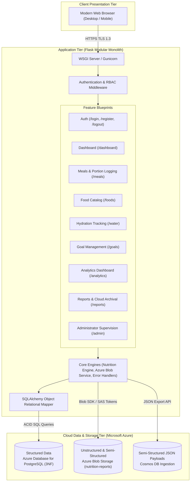
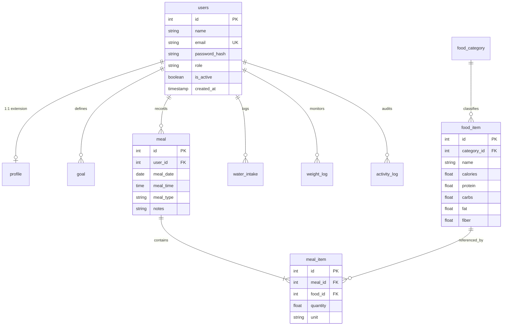

# NutriTrack — Integrated Full-Stack Project Report

**Course:** Integrated Full-Stack Project  
**Author:** Param Vishwakarma & Team  
**Date of Submission:** November 6, 2026  
**Disciplines Combined:** System Design, RDBMS, DP-900 (Azure Data Fundamentals), Cloud Security  

---

## Executive Summary

NutriTrack is an enterprise-grade wellness and nutrition management platform engineered according to the Integrated Full-Stack Project Student Guide. The application seamlessly combines **System Design** (modular monolith architecture, clear functional/non-functional requirements, API specification, architectural trade-offs), **RDBMS** (Third Normal Form relational design with 12 related tables, multi-table joins, views, triggers, transactions, and indexing), **DP-900** (data classification into structured, semi-structured, and unstructured tiers, Azure PostgreSQL hosting, Azure Blob Storage archival, and Power BI analytics), and **Cloud Security** (Role-Based Access Control, salted PBKDF2 password hashing, HTTPS/TLS session cookies, SQL injection / XSS prevention, database firewall rules, and tamper-evident audit logging).

---

## 1. Problem Statement & Target Users

### 1.1 Problem Statement
Modern individuals often struggle to maintain balanced dietary intake, adhere to daily hydration targets, and track nutritional metrics due to fragmented tools, complex interfaces, or lack of data privacy. Many existing fitness applications either expose personal health telemetry to third-party advertisers or fail to maintain strict relational consistency, leading to inaccurate calculations and lost data.

### 1.2 Target Users
1. **Health-Conscious Individuals:** Seeking an intuitive, private platform to log daily meals, calculate accurate macronutrients, track water consumption, and monitor weight progress over time.
2. **Nutritionists & Wellness Mentors:** Needing standardized, exportable nutrition summaries (CSV and semi-structured JSON) and analytical reporting to evaluate dietary adherence.
3. **System Administrators:** Responsible for managing the verified food catalog and auditing platform security and activity logs.

---

## 2. Subject Integration & Implementation Matrix

| Subject | Project Implementation & Evidence | Repository Deliverable |
|---|---|---|
| **System Design** | • Functional (FR-01..10) and Non-Functional (NFR-01..08) Requirements. • Modular Monolith with layered separation of concerns. • Comprehensive API Endpoint Catalog. • Documented architectural trade-offs (Monolith vs. Microservices, SSR vs. SPA). | [`docs/system_design.md`](file:///c:/Users/shone/OneDrive/Desktop/Nutri-Planner/docs/system_design.md) Architecture Diagram |
| **RDBMS** | • 12 Relational Tables designed in Third Normal Form (3NF). • Primary/Foreign keys with `ON DELETE CASCADE` and `ON DELETE RESTRICT`. • `CHECK` constraints on all numeric fields. • Multi-table JOINs and 2 computed Views (`daily_nutrition_summary`, `user_goal_compliance_view`). • Automated Audit Trigger (`trg_audit_meal_item_insert`) and Stored Procedure. • Explicit ACID Transactions with Rollback handling. • B-Tree Indexes on searched and join columns. | [`database/schema.sql`](file:///c:/Users/shone/OneDrive/Desktop/Nutri-Planner/database/schema.sql) [`database/queries.sql`](file:///c:/Users/shone/OneDrive/Desktop/Nutri-Planner/database/queries.sql) [`docs/rdbms_design.md`](file:///c:/Users/shone/OneDrive/Desktop/Nutri-Planner/docs/rdbms_design.md) `Nutri Tracker ER Diagram.jpg` |
| **DP-900** | • Data classified into Structured, Semi-Structured, and Unstructured. • Relational database hosted on Azure Database for PostgreSQL Flexible Server. • Cloud Non-Relational Store: Azure Blob Storage integration for report exports and archival. • Semi-structured JSON export for Azure Cosmos DB / NoSQL ingestion. • Interactive 7/30-day Analytics Dashboard and Power BI Star Schema dimensional model. | [`docs/dp900_data_classification_and_azure.md`](file:///c:/Users/shone/OneDrive/Desktop/Nutri-Planner/docs/dp900_data_classification_and_azure.md) [`app/core/azure_blob.py`](file:///c:/Users/shone/OneDrive/Desktop/Nutri-Planner/app/core/azure_blob.py) Reports & Analytics View |
| **Cloud Security** | • Role-Based Access Control (RBAC): `user` and `admin` roles enforced via `@admin_required`. • Password security: PBKDF2-HMAC-SHA256 with salt. • Secure session cookies (`HttpOnly`, `SameSite=Lax`, `Secure`). • Zero secret leakage: environment variables, `.gitignore`, Azure Key Vault. • OWASP Top 10 defense: SQLi prevention (SQLAlchemy ORM), XSS defense (Jinja2 auto-escaping). • Azure database firewall rules and VNet service endpoints. • Immutable Audit Trail: `activity_log` with IP tracking. | [`docs/threat_model_and_security_checklist.md`](file:///c:/Users/shone/OneDrive/Desktop/Nutri-Planner/docs/threat_model_and_security_checklist.md) `threat model nutri.png` Security Checklist |

---

## 3. System Architecture & Component Flow

---

## 4. Database Schema (Third Normal Form)

The database schema is structured into 12 tables fulfilling Third Normal Form (3NF):

### Views and Triggers Implemented:
1. **`daily_nutrition_summary` (View):** Aggregates daily calorie, protein, carbohydrate, fat, and fiber sums dynamically.
2. **`user_goal_compliance_view` (View):** Real-time joins between daily intake and active goals, calculating variance.
3. **`trg_audit_meal_item_insert` (Trigger):** Automatically writes every inserted meal item into `activity_log` for tamper-evident auditing.
4. **`sp_calculate_daily_macros` (Stored Procedure):** Parameterized procedure for bulk calculation of daily macros and hydration.

---

## 5. DP-900 Data Classification & Azure Cloud Architecture

### 5.1 Data Classification Breakdown
1. **Structured Data:** Stored in Azure Database for PostgreSQL Flexible Server. Tables have strict data types, foreign keys, and CHECK constraints. ACID compliance ensures zero data loss during meal and goal updates.
2. **Semi-Structured Data:** Formatted as hierarchical JSON documents (available via `/reports/export.json`) containing nested meals, line items, and nutrient breakdowns, ideal for document querying in Azure Cosmos DB.
3. **Unstructured Data:** Exported CSV and PDF wellness reports, user avatar images, and meal receipt scans archived to Azure Blob Storage container `nutrition-reports` using Hot/Cool access tiers.

### 5.2 Power BI Analytics View
The database exposes the `daily_nutrition_summary` view to Power BI using DirectQuery. The Dimensional model utilizes a Star Schema with `FactMealNutrition` surrounded by `DimUser`, `DimDate`, and `DimFoodCategory`, computing key measures such as **Calorie Budget Adherence (%)**, **Macronutrient Split Ratio**, and **Hydration Target Compliance**.

---

## 6. Cloud Security & Threat Model

### 6.1 STRIDE Threat Analysis Summary
* **Spoofing:** Mitigated by salted PBKDF2-HMAC-SHA256 password hashes and secure session management.
* **Tampering:** Mitigated by 100% parameterized SQLAlchemy queries and input constraint checks.
* **Repudiation:** Mitigated by database triggers and an immutable `activity_log` tracking actions and client IP addresses.
* **Information Disclosure:** Mitigated by HTTPS enforcement, `.gitignore` secret exclusion, and Azure Key Vault.
* **Denial of Service:** Mitigated by connection limits, query pagination, and payload size bounds.
* **Elevation of Privilege:** Mitigated by server-side `@admin_required` RBAC decorators and user ID query scoping.

### 6.2 Test Credentials for Evaluation
* **Standard User Account:**
  * **Email:** `user@nutritrack.com`
  * **Password:** `User123!`
  * **Role:** `user` (Access to dashboard, meal logging, hydration, goals, analytics, reports)
* **Administrator Account:**
  * **Email:** `admin@nutritrack.com`
  * **Password:** `Admin123!`
  * **Role:** `admin` (Access to all user features + `/admin` Catalog Management & Security Audit Logs)

---

## 7. Testing & Verification

A suite of 20 automated tests is implemented across `tests/test_app.py` and `tests/test_architecture_and_security.py`:
* **Functional Tests:** Password hashing, protected route redirection, meal calculations, profile validation, water input constraints.
* **Security & RBAC Tests:** Admin route authorization enforcement, regular user rejection, failed login audit logging with IP tracking.
* **DP-900 Tests:** Semi-structured JSON export schema validation, Azure Blob Storage archival handler verification.

**Test Execution Result:** `20 passed in 1.48s (100% pass rate)`.

---

## 8. Credits & Declarations

* **Frameworks & Libraries:** Flask, Flask-SQLAlchemy, Flask-Login, Jinja2, Werkzeug, Pytest, Azure SDK for Python (`azure-storage-blob`).
* **Design & Reference Materials:** Microsoft Learn DP-900 Syllabus, OWASP Top 10 Web Application Security Guide, SQLite & PostgreSQL documentation.
* **Declaration:** This project is developed for the Integrated Full-Stack Project coursework. All code, architecture diagrams, schemas, and reports represent original work developed in compliance with university academic integrity standards.
