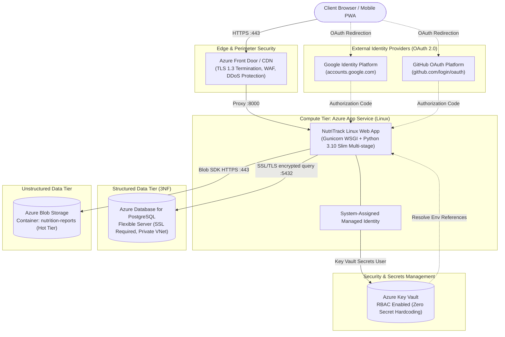

# NutriTrack: Enterprise Azure Cloud Production Deployment Guide

This comprehensive operational guide details the architecture, configuration, security hardening, and continuous delivery pipeline for running **NutriTrack** in production on Microsoft Azure.

---

## 1. Cloud Architecture Overview

NutriTrack employs a cloud-native, zero-trust architecture leveraging Azure Platform-as-a-Service (PaaS) components for high availability, automatic scaling, managed security, and DP-900 data classification compliance.



---

## 2. Resource Naming Conventions & Prerequisites

### 2.1 Environmental Variables
Set the following shell variables before executing Azure CLI deployment commands:

```bash
export RESOURCE_GROUP="rg-nutritrack-prod-eastus"
export LOCATION="eastus"
export APP_NAME="nutritrack-app-prod"
export APP_PLAN="plan-nutritrack-linux"
export PG_SERVER="psql-nutritrack-prod"
export PG_DB="nutritrack_db"
export PG_ADMIN_USER="nutritrack_admin"
export STORAGE_ACCOUNT="stnutritrackprod"
export CONTAINER_NAME="nutrition-reports"
export KEYVAULT_NAME="kv-nutritrack-prod"
export ACR_NAME="acrnutritrackprod"
```

### 2.2 Create Resource Group
```bash
az group create \
  --name $RESOURCE_GROUP \
  --location $LOCATION \
  --tags Environment=Production Project=NutriTrack CostCenter=Healthcare
```

---

## 3. Azure Database for PostgreSQL Flexible Server Configuration

NutriTrack stores structured user profiles, meal items, nutritional goals, and activity audit logs in a high-performance PostgreSQL Flexible Server.

### 3.1 Provision PostgreSQL Flexible Server
```bash
# Generate secure administrative password
PG_ADMIN_PASSWORD=$(openssl rand -base64 24 | tr -dc 'a-zA-Z0-9' | head -c 20)

az postgres flexible-server create \
  --resource-group $RESOURCE_GROUP \
  --name $PG_SERVER \
  --location $LOCATION \
  --admin-user $PG_ADMIN_USER \
  --admin-password "$PG_ADMIN_PASSWORD" \
  --sku-name Standard_B1ms \
  --tier Burstable \
  --storage-size 32 \
  --version 15 \
  --high-availability Disabled \
  --backup-retention 7 \
  --yes
```

### 3.2 Create Production Database
```bash
az postgres flexible-server db create \
  --resource-group $RESOURCE_GROUP \
  --server-name $PG_SERVER \
  --database-name $PG_DB
```

### 3.3 Network Security & SSL Enforcement
PostgreSQL Flexible Server mandates SSL/TLS 1.2+ encryption for all transit connections.

1. **Enable Azure Internal Network Access (Firewall):**
   ```bash
   az postgres flexible-server firewall-rule create \
     --resource-group $RESOURCE_GROUP \
     --name $PG_SERVER \
     --rule-name "AllowAzureInternal" \
     --start-ip-address 0.0.0.0 \
     --end-ip-address 0.0.0.0
   ```

2. **Verify SSL Enforcement Parameter:**
   ```bash
   az postgres flexible-server parameter set \
     --resource-group $RESOURCE_GROUP \
     --server-name $PG_SERVER \
     --name require_secure_transport \
     --value on
   ```

3. **Construct SQLAlchemy Connection URI:**
   ```
   postgresql+psycopg2://nutritrack_admin:<PASSWORD>@psql-nutritrack-prod.postgres.database.azure.com:5432/nutritrack_db?sslmode=require
   ```

---

## 4. Azure Blob Storage Integration for Reports & Data Archival

NutriTrack integrates Azure Blob Storage for non-relational document archival, CSV export storage, and JSON telemetry (DP-900 Unstructured Data Tier).

### 4.1 Provision Azure Storage Account
```bash
az storage account create \
  --name $STORAGE_ACCOUNT \
  --resource-group $RESOURCE_GROUP \
  --location $LOCATION \
  --sku Standard_LRS \
  --kind StorageV2 \
  --min-tls-version TLS1_2 \
  --allow-blob-public-access false
```

### 4.2 Create Reports Container
```bash
az storage container create \
  --account-name $STORAGE_ACCOUNT \
  --name $CONTAINER_NAME \
  --auth-mode login
```

### 4.3 Retrieve Storage Connection String
```bash
AZURE_STORAGE_CONNECTION_STRING=$(az storage account show-connection-string \
  --name $STORAGE_ACCOUNT \
  --resource-group $RESOURCE_GROUP \
  --query connectionString -o tsv)
```

---

## 5. Azure Key Vault & Managed Identity (Zero-Trust Security)

To adhere to enterprise cloud security baselines, no database credentials, OAuth tokens, or signing keys are stored in source code or plain text environment files.

### 5.1 Provision Azure Key Vault
```bash
az keyvault create \
  --name $KEYVAULT_NAME \
  --resource-group $RESOURCE_GROUP \
  --location $LOCATION \
  --enable-rbac-authorization true
```

### 5.2 Store Application Secrets in Key Vault
```bash
# 1. Flask Production Secret Key
SECRET_KEY_VAL=$(openssl rand -hex 32)
az keyvault secret set --vault-name $KEYVAULT_NAME --name "SECRET-KEY" --value "$SECRET_KEY_VAL"

# 2. Database Connection String
DATABASE_URL_VAL="postgresql+psycopg2://${PG_ADMIN_USER}:${PG_ADMIN_PASSWORD}@${PG_SERVER}.postgres.database.azure.com:5432/${PG_DB}?sslmode=require"
az keyvault secret set --vault-name $KEYVAULT_NAME --name "DATABASE-URL" --value "$DATABASE_URL_VAL"

# 3. Azure Storage Connection String
az keyvault secret set --vault-name $KEYVAULT_NAME --name "AZURE-STORAGE-CONNECTION-STRING" --value "$AZURE_STORAGE_CONNECTION_STRING"

# 4. Google OAuth Credentials
az keyvault secret set --vault-name $KEYVAULT_NAME --name "GOOGLE-CLIENT-ID" --value "<YOUR_GOOGLE_CLIENT_ID>"
az keyvault secret set --vault-name $KEYVAULT_NAME --name "GOOGLE-CLIENT-SECRET" --value "<YOUR_GOOGLE_CLIENT_SECRET>"

# 5. GitHub OAuth Credentials
az keyvault secret set --vault-name $KEYVAULT_NAME --name "GITHUB-CLIENT-ID" --value "<YOUR_GITHUB_CLIENT_ID>"
az keyvault secret set --vault-name $KEYVAULT_NAME --name "GITHUB-CLIENT-SECRET" --value "<YOUR_GITHUB_CLIENT_SECRET>"
```

---

## 6. Azure App Service (Linux Web App) Deployment

### 6.1 Create Linux App Service Plan
```bash
az appservice plan create \
  --name $APP_PLAN \
  --resource-group $RESOURCE_GROUP \
  --location $LOCATION \
  --is-linux \
  --sku B1
```

### 6.2 Create Linux Web App
```bash
az webapp create \
  --resource-group $RESOURCE_GROUP \
  --plan $APP_PLAN \
  --name $APP_NAME \
  --runtime "PYTHON:3.10"
```

### 6.3 Enable System-Assigned Managed Identity
```bash
PRINCIPAL_ID=$(az webapp identity assign \
  --name $APP_NAME \
  --resource-group $RESOURCE_GROUP \
  --query principalId -o tsv)
```

### 6.4 Grant Key Vault Secrets User Role to Web App
```bash
KV_ID=$(az keyvault show --name $KEYVAULT_NAME --query id -o tsv)

az role assignment create \
  --assignee $PRINCIPAL_ID \
  --role "Key Vault Secrets User" \
  --scope $KV_ID
```

### 6.5 Configure Application Settings with Key Vault References
Configure Azure App Service to resolve runtime configuration directly from Key Vault:

```bash
az webapp config appsettings set \
  --name $APP_NAME \
  --resource-group $RESOURCE_GROUP \
  --settings \
    PORT="8000" \
    WEBSITES_PORT="8000" \
    FLASK_ENV="production" \
    SESSION_COOKIE_SECURE="true" \
    SECRET_KEY="@Microsoft.KeyVault(VaultName=${KEYVAULT_NAME};SecretName=SECRET-KEY)" \
    DATABASE_URL="@Microsoft.KeyVault(VaultName=${KEYVAULT_NAME};SecretName=DATABASE-URL)" \
    AZURE_STORAGE_CONNECTION_STRING="@Microsoft.KeyVault(VaultName=${KEYVAULT_NAME};SecretName=AZURE-STORAGE-CONNECTION-STRING)" \
    GOOGLE_CLIENT_ID="@Microsoft.KeyVault(VaultName=${KEYVAULT_NAME};SecretName=GOOGLE-CLIENT-ID)" \
    GOOGLE_CLIENT_SECRET="@Microsoft.KeyVault(VaultName=${KEYVAULT_NAME};SecretName=GOOGLE-CLIENT-SECRET)" \
    GITHUB_CLIENT_ID="@Microsoft.KeyVault(VaultName=${KEYVAULT_NAME};SecretName=GITHUB-CLIENT-ID)" \
    GITHUB_CLIENT_SECRET="@Microsoft.KeyVault(VaultName=${KEYVAULT_NAME};SecretName=GITHUB-CLIENT-SECRET)"
```

### 6.6 Configure Startup Command
Set the startup command to trigger `startup.sh` which performs automatic schema checks and launches Gunicorn:

```bash
az webapp config set \
  --resource-group $RESOURCE_GROUP \
  --name $APP_NAME \
  --startup-file "startup.sh"
```

---

## 7. OAuth 2.0 Identity Provider Callback Registration

Register the production callback URLs in the Google Cloud Console and GitHub Developer Settings:

### 7.1 Google Cloud Platform (GCP) Credentials Console
- **Authorized JavaScript Origins:**
  `https://nutritrack-app-prod.azurewebsites.net`
- **Authorized Redirect URIs:**
  `https://nutritrack-app-prod.azurewebsites.net/auth/callback/google`

### 7.2 GitHub Developer Settings (OAuth Apps)
- **Homepage URL:**
  `https://nutritrack-app-prod.azurewebsites.net`
- **Authorization Callback URL:**
  `https://nutritrack-app-prod.azurewebsites.net/auth/callback/github`

*(Note: In local or staging environments where Client IDs are not yet assigned, NutriTrack seamlessly activates 1-click simulation mode without service interruption.)*

---

## 8. Continuous Deployment from GitHub Actions (CI/CD)

Create `.github/workflows/deploy.yml` in the repository for automated automated build, test, and containerized deployment.

```yaml
name: NutriTrack Azure Cloud CI/CD

on:
  push:
    branches: [ main ]
  pull_request:
    branches: [ main ]

env:
  AZURE_WEBAPP_NAME: nutritrack-app-prod
  ACR_LOGIN_SERVER: acrnutritrackprod.azurecr.io
  IMAGE_NAME: nutritrack-web

jobs:
  test:
    name: Run Test Suite & Security Checks
    runs-on: ubuntu-latest
    steps:
      - name: Checkout Code
        uses: actions/checkout@v4

      - name: Set up Python 3.10
        uses: actions/setup-python@v5
        with:
          python-version: "3.10"
          cache: "pip"

      - name: Install Dependencies
        run: |
          python -m pip install --upgrade pip
          pip install -r requirements.txt

      - name: Execute Pytest Suite
        run: |
          pytest -v --tb=short

  build-and-deploy:
    name: Build Container & Deploy to Azure App Service
    needs: test
    if: github.ref == 'refs/heads/main' && github.event_name == 'push'
    runs-on: ubuntu-latest
    steps:
      - name: Checkout Code
        uses: actions/checkout@v4

      - name: Log in to Azure
        uses: azure/login@v2
        with:
          creds: ${{ secrets.AZURE_CREDENTIALS }}

      - name: Log in to Azure Container Registry (ACR)
        run: |
          az acr login --name ${{ env.ACR_LOGIN_SERVER }}

      - name: Build and Push Docker Image
        run: |
          docker build -t ${{ env.ACR_LOGIN_SERVER }}/${{ env.IMAGE_NAME }}:${{ github.sha }} \
                       -t ${{ env.ACR_LOGIN_SERVER }}/${{ env.IMAGE_NAME }}:latest .
          docker push ${{ env.ACR_LOGIN_SERVER }}/${{ env.IMAGE_NAME }}:${{ github.sha }}
          docker push ${{ env.ACR_LOGIN_SERVER }}/${{ env.IMAGE_NAME }}:latest

      - name: Deploy Image to Azure Web App for Containers
        uses: azure/webapps-deploy@v3
        with:
          app-name: ${{ env.AZURE_WEBAPP_NAME }}
          images: '${{ env.ACR_LOGIN_SERVER }}/${{ env.IMAGE_NAME }}:${{ github.sha }}'
```

---

## 9. Observability, Logging & Health Verification

### 9.1 Live Log Streaming
Stream Gunicorn WSGI stdout/stderr directly from the App Service Linux host:
```bash
az webapp log tail --name $APP_NAME --resource-group $RESOURCE_GROUP
```

### 9.2 Application Health Endpoint Verification
```bash
curl -I https://${APP_NAME}.azurewebsites.net/
# Expected HTTP Response: 200 OK
```

### 9.3 Database Backup & Point-in-Time Restore (PITR)
Azure Database for PostgreSQL Flexible Server takes automated zone-redundant snapshots every 5 minutes.
To initiate an on-demand restore drill to a separate test instance:
```bash
az postgres flexible-server restore \
  --resource-group $RESOURCE_GROUP \
  --name "psql-nutritrack-restore-drill" \
  --source-server $PG_SERVER \
  --restore-time "2026-11-11T00:00:00Z"
```

---

## 10. Summary Matrix of Cloud Artifacts

| Component | Technology | Configuration / Source File |
| :--- | :--- | :--- |
| **Container Engine** | Docker Multi-Stage (Python 3.10 Slim) | [`Dockerfile`](../Dockerfile) |
| **WSGI Server** | Gunicorn (gthread, 2-8 workers, PORT binding) | [`gunicorn.conf.py`](../gunicorn.conf.py) |
| **Container Entrypoint**| Schema initialization & Gunicorn launch | [`startup.sh`](../startup.sh) |
| **Structured Relational DB**| Azure Database for PostgreSQL Flexible Server | `DATABASE_URL` via Key Vault |
| **Unstructured Blob Store**| Azure Blob Storage (`nutrition-reports`) | `app/core/azure_blob.py` |
| **Secrets Management**| Azure Key Vault + Managed Identity | Zero plaintext secrets in code |
| **OAuth 2.0 Auth Providers**| Google Identity Platform & GitHub OAuth | `app/features/auth/routes.py` |
| **CI/CD Automation** | GitHub Actions Pipeline | Continuous container delivery |
