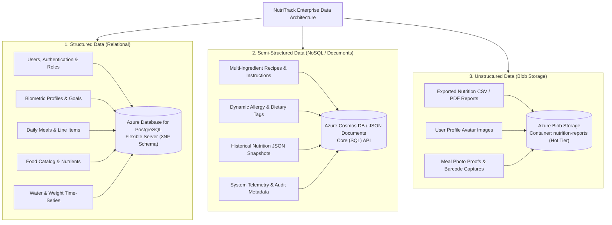
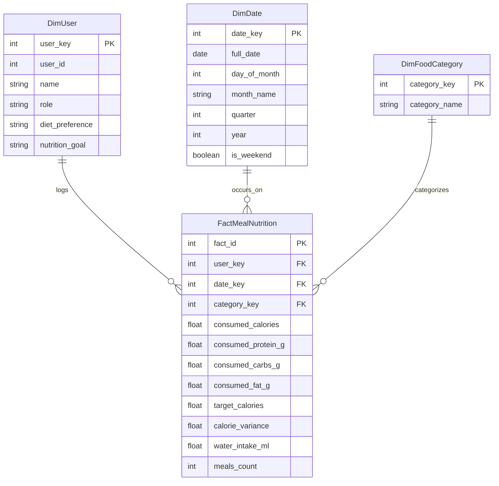

# DP-900: Data Classification & Azure Cloud Architecture

**Course Component:** DP-900 (Azure Data Fundamentals) (20 Marks)  
**Deliverables:** Data Classification Note, Azure Resource Architecture, Analytics & Power BI Report Design  

---

## 1. Data Classification Note

In alignment with Microsoft Azure Data Fundamentals (DP-900), the data handled by NutriTrack is categorized into **Structured**, **Semi-Structured**, and **Unstructured** data tiers based on schema requirements, access patterns, and storage optimization:



### Detailed Classification Matrix:

| Classification | Data Attributes | Primary Characteristics | Target Azure Service | Storage Format |
|---|---|---|---|---|
| **Structured Data** | User credentials, biometric profiles, meal logs, meal line items, hydration logs, target goals, activity logs | Strictly defined schema-on-write; strong relational integrity with foreign keys and check constraints; full ACID transaction support; queryable via ANSI SQL. | **Azure Database for PostgreSQL Flexible Server** (or Azure SQL Database) | Relational Tables (Row-based storage with B-Tree indexes) |
| **Semi-Structured Data** | Dynamic meal recipes, custom food ingredient mappings, diet tags, serialized JSON export telemetry | Self-describing data with hierarchical key-value pairs; schema-on-read flexibility allowing varied attributes per record; nested structures. | **Azure Cosmos DB** (or Azure Synapse Analytics serverless JSON ingestion) | JSON documents / BSON format |
| **Unstructured Data** | Exported CSV nutrition datasets, generated PDF wellness reports, profile pictures, meal camera snaps | Binary / text objects with no internal relational schema; bulk storage optimized for streaming and batch retrieval; high durability. | **Azure Blob Storage** (Container: `nutrition-reports`, Tier: Hot / Cool) | Block Blobs (`.csv`, `.pdf`, `.png`, `.jpg`) |

---

## 2. Azure Cloud Architecture & Provisioning

### 2.1 Solution Topology

The application is deployed across four integrated Azure PaaS (Platform as a Service) resources:

```mermaid
flowchart LR
    User["End User / Browser"]
    
    subgraph AzureCloud ["Microsoft Azure Cloud (Region: Central India / East US)"]
        AppService["Azure App Service (Linux Web App)\nPython 3.10 Runtime\nGunicorn WSGI Server"]
        KeyVault["Azure Key Vault\nSecure Secrets Storage\n(DB_URL, SECRET_KEY)"]
        
        subgraph VNet ["Secure Virtual Network (VNet)"]
            Postgres["Azure Database for PostgreSQL\nFlexible Server\nPrivate Endpoint / VNet Integration\nFirewall Rule: Allow App Service Only"]
        end

        Blob["Azure Blob Storage\nAccount: nutritrackstorage\nContainer: nutrition-reports\nPrivate Access with SAS Tokens"]
        
        PowerBI["Power BI Service\nInteractive Executive Dashboard\nDirectQuery / Import from SQL View"]
    end

    User -->|HTTPS (TLS 1.3)| AppService
    AppService -->|Managed Identity| KeyVault
    AppService -->|Encrypted SQL Connection (SSL)| Postgres
    AppService -->|Azure Storage SDK / SAS Token| Blob
    Postgres -.->|Scheduled ETL / DirectQuery| PowerBI
    PowerBI -->|Embedded Analytics| User
```

### 2.2 Provisioned Azure Resources

1. **Azure App Service (Web App)**
   - **SKU:** Basic B1 / Free F1 Linux.
   - **Runtime Stack:** Python 3.10.
   - **Configuration:** Managed Identity enabled to retrieve database credentials and storage connection strings securely from Azure Key Vault without embedding secrets in environment variables or code.

2. **Azure Database for PostgreSQL Flexible Server**
   - **SKU:** Burstable B1ms (1 vCore, 2 GiB RAM, 32 GiB Storage).
   - **Security:** TLS 1.2+ enforced; public access disabled; firewall configured with specific IP allowlists and Virtual Network Service Endpoints.

3. **Azure Blob Storage Account (`nutritrackstorage`)**
   - **Account Kind:** StorageV2 (General Purpose v2).
   - **Redundancy:** Locally Redundant Storage (LRS) for dev/test; Geo-Redundant Storage (GRS) for production.
   - **Containers:** `nutrition-reports` (Private, access controlled via Short-lived Shared Access Signatures - SAS).

4. **Azure Key Vault (`nutritrack-kv`)**
   - Stores `DATABASE-URL`, `SECRET-KEY`, and `AZURE-STORAGE-CONNECTION-STRING`.
   - Access controlled strictly via Azure Active Directory (Microsoft Entra ID) Role-Based Access Control.

---

## 3. Analytics View & Power BI Report Design

### 3.1 Star Schema Data Model for Business Intelligence

To facilitate high-performance analytical reporting in Power BI or Azure Synapse, the operational 3NF schema is projected into a **Star Schema** dimensional model via the `daily_nutrition_summary` view:



### 3.2 Key Performance Indicators (KPIs) & DAX Measures

1. **Daily Calorie Adherence Rate (%):**
   $$\text{Adherence Rate} = \frac{\text{Count of Days where } |\text{Variance}| \le 150 \text{ kcal}}{\text{Total Logged Days}} \times 100$$
   *DAX Formula:*
   ```dax
   Calorie_Adherence_Pct = 
   DIVIDE(
       CALCULATE(COUNTROWS(FactMealNutrition), ABS(FactMealNutrition[calorie_variance]) <= 150),
       COUNTROWS(FactMealNutrition),
       0
   ) * 100
   ```

2. **Macronutrient Split Ratio (%):**
   * Protein Contribution: $\frac{\text{Protein (g)} \times 4}{\text{Total Calories}} \times 100$
   * Carbohydrate Contribution: $\frac{\text{Carbs (g)} \times 4}{\text{Total Calories}} \times 100$
   * Fat Contribution: $\frac{\text{Fat (g)} \times 9}{\text{Total Calories}} \times 100$

3. **Hydration Target Compliance:**
   ```dax
   Hydration_Compliance = 
   DIVIDE(
       SUM(FactMealNutrition[water_intake_ml]),
       SUM(DimUser[target_water_ml]),
       0
   )
   ```

### 3.3 Power BI Report Visualizations
* **Visual 1 (Gauge Chart):** Current Day Calorie Intake vs. Daily Budget.
* **Visual 2 (100% Stacked Bar Chart):** Macro distribution (Protein vs. Carbs vs. Fat).
* **Visual 3 (Line & Clustered Column Chart):** 30-Day Calorie Trend (bars) plotted against Daily Weight Progress (line).
* **Visual 4 (Decomposition Tree):** Breakdown of calorie consumption by Meal Type (Breakfast, Lunch, Dinner, Snack) across food categories.
