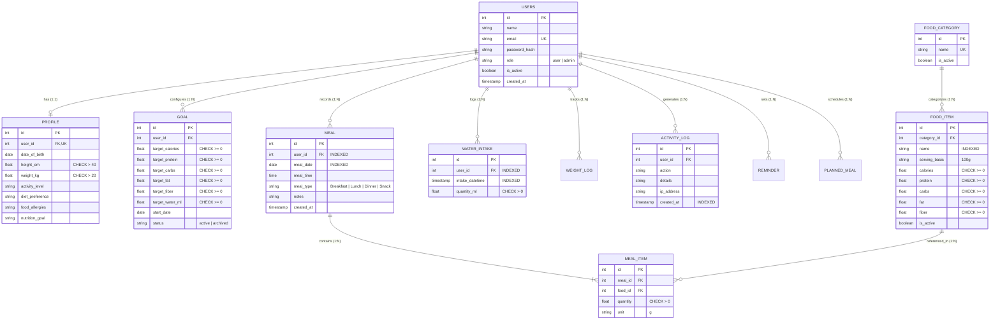

# Relational Database Management System (RDBMS) Specification

**Course Component:** RDBMS (20 Marks)  
**Database Engine:** SQLite 3.x (Local Dev) / Azure Database for PostgreSQL Flexible Server (Cloud Prod)  
**Schema Normalization:** Third Normal Form (3NF)  

---

## 1. Third Normal Form (3NF) Normalization Analysis

The NutriTrack relational schema has been designed from first principles to satisfy **Third Normal Form (3NF)** across all entities, eliminating update, insertion, and deletion anomalies.

### Normal Form Verification:

1. **First Normal Form (1NF) Compliance:**
   - Every column contains only atomic, indivisible values.
   - No repeating groups or comma-separated lists in operational transactional tables.
   - Every table possesses a defined Primary Key (`id`).

2. **Second Normal Form (2NF) Compliance:**
   - The schema is in 1NF.
   - All non-key attributes are fully functionally dependent on the entire primary key (no partial dependencies on composite keys).
   - In associative tables like `meal_item`, synthetic surrogate primary keys (`id`) are utilized alongside strict composite foreign keys (`meal_id`, `food_id`).

3. **Third Normal Form (3NF) Compliance:**
   - The schema is in 2NF.
   - There are **no transitive functional dependencies** ($X \rightarrow Y$ where $Y \rightarrow Z$).
   - *Example 1:* Food nutritional values (`calories`, `protein`, `carbs`, `fat`, `fiber`) depend solely on `food_item.id`. They are **never stored** redundantly in `meal_item` or `meal`. Daily meal totals are dynamically computed via SQL views and join aggregations.
   - *Example 2:* User profile metrics (`height_cm`, `weight_kg`, `activity_level`) are isolated in the `profile` table referencing `users.id` (1:1 relation), keeping authentication credentials lean and independent.
   - *Example 3:* Food categories are normalized into `food_category` so changes to category names propagate automatically without modifying individual food records.

---

## 2. Entity-Relationship (ER) Diagram



---

## 3. Relational Schema & Integrity Constraints

The complete DDL is maintained in [`database/schema.sql`](file:///c:/Users/shone/OneDrive/Desktop/Nutri-Planner/database/schema.sql).

### Key Integrity Constraints:
1. **Primary & Unique Keys:**
   - `users(id)`: Surrogate auto-incrementing integer PK.
   - `users(email)`: Unique candidate key with case-insensitive unique constraint.
   - `profile(user_id)`: Unique foreign key ensuring strict 1:1 cardinal constraint.
   - `food_category(name)`: Unique business constraint preventing redundant categories.

2. **Foreign Keys & Referential Actions:**
   - `profile.user_id -> users.id`: `ON DELETE CASCADE` ensures child biometric records are purged upon user account deletion.
   - `meal.user_id -> users.id`: `ON DELETE CASCADE`.
   - `meal_item.meal_id -> meal.id`: `ON DELETE CASCADE` preserves cascade deletion of line items when parent meal header is deleted.
   - `meal_item.food_id -> food_item.id`: `ON DELETE RESTRICT` prevents accidental deletion of catalog food items that are actively referenced in historical user logs.
   - `activity_log.user_id -> users.id`: `ON DELETE SET NULL` ensures audit trail records are retained even if user accounts are permanently purged.

3. **Check Constraints (`CHECK`):**
   - Nutritional values: `calories >= 0`, `protein >= 0`, `carbs >= 0`, `fat >= 0`, `fiber >= 0`.
   - Consumption quantities: `quantity > 0`, `quantity_ml > 0`.
   - Biometric validity: `height_cm BETWEEN 40 AND 280`, `weight_kg BETWEEN 20 AND 350`.
   - Domain enumerations: `role IN ('user', 'admin')`, `meal_type IN ('Breakfast', 'Lunch', 'Dinner', 'Snack')`.

---

## 4. Database Views

### View 1: `daily_nutrition_summary`
Aggregates nutritional intake for each user on each active day by joining `meal`, `meal_item`, and `food_item`:
```sql
CREATE VIEW daily_nutrition_summary AS
SELECT 
    m.user_id, 
    m.meal_date,
    COUNT(DISTINCT m.id) AS total_meals_logged,
    COUNT(mi.id) AS total_food_items,
    ROUND(SUM(fi.calories * mi.quantity / CASE WHEN fi.serving_basis = '100g' THEN 100.0 ELSE 1.0 END), 2) AS calories,
    ROUND(SUM(fi.protein * mi.quantity / CASE WHEN fi.serving_basis = '100g' THEN 100.0 ELSE 1.0 END), 2) AS protein,
    ROUND(SUM(fi.carbs * mi.quantity / CASE WHEN fi.serving_basis = '100g' THEN 100.0 ELSE 1.0 END), 2) AS carbs,
    ROUND(SUM(fi.fat * mi.quantity / CASE WHEN fi.serving_basis = '100g' THEN 100.0 ELSE 1.0 END), 2) AS fat,
    ROUND(SUM(fi.fiber * mi.quantity / CASE WHEN fi.serving_basis = '100g' THEN 100.0 ELSE 1.0 END), 2) AS fiber
FROM meal m 
JOIN meal_item mi ON mi.meal_id = m.id 
JOIN food_item fi ON fi.id = mi.food_id
GROUP BY m.user_id, m.meal_date;
```

### View 2: `user_goal_compliance_view`
Joins the summary view with active nutritional goals to compute variance in real-time:
```sql
CREATE VIEW user_goal_compliance_view AS
SELECT 
    dns.user_id,
    dns.meal_date,
    dns.calories AS actual_calories,
    g.target_calories,
    ROUND(dns.calories - g.target_calories, 2) AS calorie_variance,
    dns.protein AS actual_protein,
    g.target_protein,
    dns.carbs AS actual_carbs,
    g.target_carbs,
    dns.fat AS actual_fat,
    g.target_fat
FROM daily_nutrition_summary dns
JOIN goal g ON g.user_id = dns.user_id AND g.status = 'active';
```

---

## 5. Triggers & Stored Procedures

### 5.1 Database Trigger (`trg_audit_meal_item_insert`)
Guarantees non-repudiation and audit logging at the database level:
```sql
CREATE TRIGGER trg_audit_meal_item_insert
AFTER INSERT ON meal_item
FOR EACH ROW
BEGIN
    INSERT INTO activity_log (user_id, action, details, ip_address, created_at)
    SELECT 
        m.user_id,
        'meal_item_logged_trigger',
        'Automatic audit trigger: Added food_id ' || NEW.food_id || ' (' || NEW.quantity || 'g) to meal_id ' || NEW.meal_id,
        '127.0.0.1',
        CURRENT_TIMESTAMP
    FROM meal m
    WHERE m.id = NEW.meal_id;
END;
```

### 5.2 Stored Procedure (`sp_calculate_daily_macros`)
Available for PostgreSQL and enterprise RDBMS engines in `database/queries.sql`, encapsulating daily macro calculation and water intake into an atomic function.

---

## 6. Transactions & ACID Guarantees

Meal logging involves inserting a header record into `meal` and multiple child items into `meal_item`. To prevent partial records in the event of an error:
```sql
BEGIN TRANSACTION;
INSERT INTO meal (user_id, meal_date, meal_time, meal_type, notes) VALUES (1, CURRENT_DATE, '12:30', 'Lunch', 'Gym lunch');
INSERT INTO meal_item (meal_id, food_id, quantity, unit) VALUES (last_insert_rowid(), 2, 150.0, 'g');
INSERT INTO meal_item (meal_id, food_id, quantity, unit) VALUES (last_insert_rowid(), 1, 100.0, 'g');
COMMIT;
```
If an error occurs at any point (e.g. quantity <= 0), `ROLLBACK` is executed, preserving complete database integrity.

---

## 7. Indexing Strategy & Performance Analysis

| Index Name | Table | Indexed Columns | Justification / Query Pattern |
|---|---|---|---|
| `ix_users_email` | `users` | `email` | Rapid lookup during login and registration uniqueness checks ($O(\log N)$). |
| `ix_food_item_name` | `food_item` | `name` | Accelerates user text searches in catalog. |
| `ix_food_item_category`| `food_item` | `category_id` | Speeds up JOIN operations between category dimension and food items. |
| `ix_meal_user_date` | `meal` | `user_id, meal_date` | Composite index directly servicing dashboard and daily summary queries. |
| `ix_water_intake_user_time`| `water_intake` | `user_id, intake_datetime` | Optimizes time-series hydration aggregation and daily reporting. |
| `ix_activity_log_user_created`| `activity_log` | `user_id, created_at` | Speeds up administrative audit trail inspection. |

Verified using SQLite `EXPLAIN QUERY PLAN` showing B-Tree index lookups instead of full table scans (`SCAN TABLE`).
