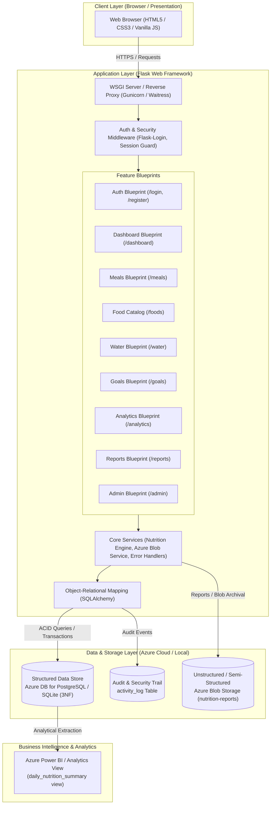
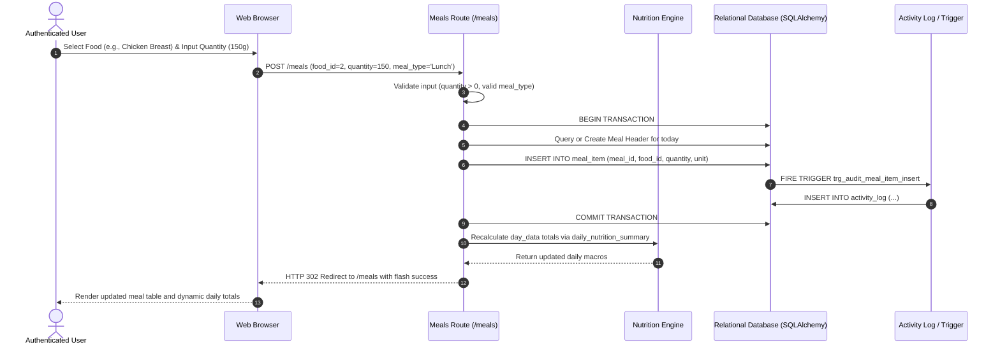

# System Design Specification: NutriTrack

**Course Component:** System Design (20 Marks)  
**Project:** NutriTrack — Integrated Full-Stack Wellness & Nutrition Platform  
**Target Milestone:** Design Review & Final Submission  

---

## 1. System Overview

NutriTrack is an integrated, modular full-stack web application designed to empower individuals to record meals, track macronutrient and micronutrient targets, monitor hydration, establish wellness goals, and gain actionable health insights. The system combines robust transactional consistency with cloud scalability, role-based access control, and analytical reporting.

---

## 2. Requirements Analysis

### 2.1 Functional Requirements (FR)

| ID | Category | Requirement Description |
|---|---|---|
| **FR-01** | **Authentication & RBAC** | The system must allow users to register with email and password, hash passwords, maintain session state, and enforce Role-Based Access Control (`user`, `admin`). |
| **FR-02** | **Profile Management** | Authenticated users can record and update personal biometric metrics: date of birth, height (cm), weight (kg), activity level, dietary preference, food allergies, and wellness targets. |
| **FR-03** | **Nutrition Catalog Search** | The system must provide a searchable catalog of categorized foods with nutritional breakdown (calories, protein, carbs, fat, fiber) on a standardized basis (100g). |
| **FR-04** | **Meal & Portion Logging** | Users can log meals categorized by meal type (Breakfast, Lunch, Dinner, Snack) with gram-based portions. Nutrients must be dynamically calculated and rounded using half-up arithmetic. |
| **FR-05** | **Hydration Tracking** | Users can record daily water intake in milliliters and track adherence against daily hydration targets. |
| **FR-06** | **Goal Setting & Monitoring** | Users can configure daily target thresholds for calories, macronutrients (protein, carbs, fat), fiber, and water intake. |
| **FR-07** | **Interactive Dashboard** | A personalized dashboard displaying daily consumed vs. target calories, macronutrient progress bars, recent meals, hydration gauge, and rule-based wellness suggestions. |
| **FR-08** | **Analytics & Trends** | The system must provide 7-day and 30-day aggregated trends, average nutrient consumption, meal frequency, and weight progress history. |
| **FR-09** | **Data Export & Cloud Archival** | Users can export nutrition records as structured CSV files, semi-structured JSON documents (for Cosmos DB / NoSQL ingestion), and archive reports directly to Azure Blob Storage. |
| **FR-10** | **Admin Supervision & Audit** | Administrators can view all food items, toggle catalog status, and inspect tamper-evident user activity logs with IP addresses and timestamps. |

### 2.2 Non-Functional Requirements (NFR)

| ID | Attribute | Specification |
|---|---|---|
| **NFR-01** | **Security** | Passwords must be hashed using PBKDF2 with SHA-256 and salted. Sessions must use `HttpOnly`, `SameSite=Lax`, and `Secure` cookies. Secrets must remain out of source control. |
| **NFR-02** | **Performance** | API and page render latency must be under 200ms for 95% of standard read/write requests under nominal load. |
| **NFR-03** | **Data Integrity** | Relational data must adhere to Third Normal Form (3NF) with referential integrity (`FOREIGN KEY`), strict domain validation (`CHECK` constraints), and ACID transactions. |
| **NFR-04** | **Scalability** | Application architecture must be modular and stateless with respect to worker threads, allowing horizontal scaling behind a reverse proxy or Azure App Service. |
| **NFR-05** | **Reliability** | Database connection pooling, automatic schema migration checks, and graceful fallbacks for cloud storage services during offline or network interruptions. |
| **NFR-06** | **Maintainability** | Feature-based modular blueprint architecture (`routes.py`, `services.py`, `templates/`) ensuring high cohesion and low coupling. |
| **NFR-07** | **Usability** | Responsive web interface compatible with mobile, tablet, and desktop viewports, with intuitive navigation and accessibility. |
| **NFR-08** | **Auditability** | Security-sensitive actions (authentication attempts, meal operations, administrative changes) must be permanently recorded in an immutable audit trail (`activity_log`). |

---

## 3. High-Level Architecture & Component Flow

The system employs a **Modular Monolith** architecture with layered separation of concerns:

### Data Flow for Meal Logging:

---

## 4. API Catalog & Endpoint Specification

| HTTP Method | Endpoint | Auth Required | Role | Description & Parameters | Response / View |
|---|---|---|---|---|---|
| `GET` | `/` | No | Public | Landing page with feature overview and guest call-to-action | `dashboard/index.html` |
| `GET`, `POST` | `/register` | No | Public | User registration form (fields: `name`, `email`, `password`, `confirm_password`) | 200 OK / 302 Redirect |
| `GET`, `POST` | `/login` | No | Public | User authentication and session establishment | 200 OK / 302 Redirect |
| `GET` | `/logout` | Yes | Any | Invalidates active user session and logs event | 302 Redirect to `/` |
| `GET` | `/dashboard` | Yes | Any | Personal wellness dashboard, macro progress, water gauge | `dashboard/dashboard.html` |
| `GET`, `POST` | `/profile` | Yes | Any | View and update user biometrics, allergies, and targets | `profile/profile.html` |
| `GET` | `/foods` | Yes | Any | Search food catalog by query string `?q=...` | `food_catalog/foods.html` |
| `GET`, `POST` | `/meals` | Yes | Any | View daily meal items or log new meal item (`food_id`, `quantity`, `meal_type`) | `meals/meals.html` |
| `POST` | `/meals/<id>/delete` | Yes | Any | Deletes specific meal item belonging to current user | 302 Redirect to `/meals` |
| `POST` | `/meals/<id>/duplicate`| Yes | Any | Duplicates existing meal entry to today's date | 302 Redirect to `/meals` |
| `GET`, `POST` | `/water` | Yes | Any | View hydration log or record intake in ml (`quantity`) | `water/water.html` |
| `GET`, `POST` | `/goals` | Yes | Any | View or update target calories, protein, carbs, fat, water | `nutrition/goals.html` |
| `GET` | `/analytics` | Yes | Any | 7-day and 30-day macro history and weight progression (`period=7\|30`) | `analytics/analytics.html` |
| `GET` | `/reports` | Yes | Any | Nutrition report generation and cloud export console | `reports/reports.html` |
| `GET` | `/reports/export.csv` | Yes | Any | Exports structured CSV dataset for specified date range (`start`, `end`) | `text/csv` attachment |
| `GET` | `/reports/export.json`| Yes | Any | Exports semi-structured JSON document (DP-900 / Cosmos DB schema) | `application/json` attachment |
| `POST` | `/reports/archive-blob`| Yes | Any | Uploads report to Azure Blob Storage container `nutrition-reports` | `reports/reports.html` confirmation |
| `GET` | `/admin` | Yes | **admin** | Restricted administrator console: food catalog status and audit log | `admin/admin.html` |
| `GET`, `POST` | `/settings` | Yes | Any | Notification preferences and reminder intervals | `account/settings.html` |

---

## 5. Architectural Trade-Off Analysis

### 5.1 Trade-Off 1: Modular Monolith vs. Microservices Architecture
* **Context:** The application coordinates user management, nutrition calculation, hydration, report generation, and administration.
* **Option A — Microservices Architecture:** Split into standalone services: Auth Service, Catalog Service, Meal Service, Reporting Service, each with independent databases and REST/gRPC communication.
  * *Drawbacks:* High operational complexity, distributed transaction overhead (Saga pattern required for meal logging), network latency between services, increased cloud hosting costs for students/small teams.
* **Option B — Modular Monolith (Chosen):** Single deployable unit partitioned into decoupled Flask blueprints (`auth`, `meals`, `reports`, `admin`) sharing a single transactional relational database.
  * *Advantages:* Strong ACID transactional guarantees for financial/health data, zero inter-process network overhead, streamlined CI/CD pipeline, and rapid development while preserving clean modular boundaries for future microservice extraction if load demands.

### 5.2 Trade-Off 2: Database Strategy — Relational (PostgreSQL / SQLite) vs. Document Store (MongoDB / Cosmos DB)
* **Context:** Nutrition calculations require exact relations between foods, meals, users, and categories.
* **Decision:** A strict **Relational Database (RDBMS in 3NF)** was chosen as primary store. Nutrition tracking relies heavily on referential integrity (e.g. deleting a meal cascades to items; updating food reference requires strict foreign keys). Mathematical aggregations (daily calorie sums, macronutrient percentage variance) are executed natively and efficiently in RDBMS engine via SQL Views and JOINs rather than client-side loop computation.
* **Hybrid Cloud Extension:** Semi-structured data (recipes, export documents) is modeled using JSON payloads, achieving the benefits of both paradigms without sacrificing ACID consistency.

### 5.3 Trade-Off 3: Server-Side Rendering (Jinja2) vs. Single Page Application (React / Angular)
* **Decision:** **Server-Side Rendering (SSR) with Jinja2** complemented by lightweight progressive JavaScript.
* **Rationale:** Reduces client-side bundle size to zero, provides instantaneous First Contentful Paint (FCP), enhances security by keeping all state validation and business calculation on the server, and eliminates CSRF/token synchronization complexities common in decoupled SPAs.
