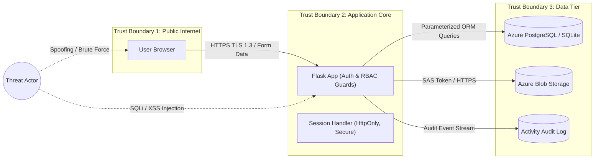

# Cloud Security: Threat Model & Security Checklist

**Course Component:** Cloud Security (20 Marks)  
**Deliverables:** One-Page Threat Model (STRIDE Methodology) & Completed Security Checklist  

---

## 1. One-Page Threat Model (STRIDE Methodology)

### 1.1 System Architecture Scope & Trust Boundaries
The NutriTrack application processes personal health and biometric data. The threat model identifies potential attack vectors across three distinct trust boundaries:
1. **Trust Boundary 1:** External Public Internet $\longleftrightarrow$ Reverse Proxy / Flask Web Application.
2. **Trust Boundary 2:** Application Layer $\longleftrightarrow$ Relational Database & Azure Blob Storage.
3. **Trust Boundary 3:** Application Session $\longleftrightarrow$ Client Browser (Cookies & Local State).

---

### 1.2 STRIDE Threat Classification & Mitigations

| STRIDE Category | Threat Description | Severity | Implemented Mitigation in NutriTrack |
|---|---|---|---|
| **S — Spoofing** | Adversary attempts to guess credentials, forge sessions, or impersonate another user or administrator. | **HIGH** | Passwords hashed using PBKDF2 with SHA-256 and unique salt. Cryptographically signed session cookies with secret key. Safe redirect verification (`is_safe_redirect_target`) preventing open redirect phishing. |
| **T — Tampering** | Adversary injects malicious SQL or scripts to alter database state, food items, or bypass price/calorie checks. | **CRITICAL** | 100% Parameterized queries via SQLAlchemy ORM (SQL Injection immune). Form fields validated with strict bounds (`quantity > 0`). Jinja2 auto-escaping prevents XSS script injection into DOM. |
| **R — Repudiation** | Malicious actor denies performing unauthorized operations (e.g. deleting meals or tampering with catalog). | **MEDIUM** | Dedicated `ActivityLog` table and database trigger (`trg_audit_meal_item_insert`) logging user ID, action, details, client IP address (`get_client_ip()`), and UTC timestamps. |
| **I — Information Disclosure** | Exposure of user biometrics, password hashes, or cloud secrets in logs, repositories, or network transit. | **HIGH** | Forced HTTPS/TLS in production. Strict `.gitignore` preventing `.env` or credential leakage. Database connection string stored in environment / Azure Key Vault. Standardized JSON error responses suppressing debug tracebacks. |
| **D — Denial of Service** | Resource exhaustion via oversized payload submissions or flood of unauthenticated requests. | **MEDIUM** | Request payload size limits enforced by WSGI server. Pagination and limits on catalog search and activity logs (`limit(50)`). Database connection pooling with timeout limits. |
| **E — Elevation of Privilege** | Standard user attempts to access administrative catalog control or view other users' meals. | **CRITICAL** | Role-Based Access Control (RBAC): `@admin_required` decorator validates role == 'admin' before serving `/admin`. All feature queries enforce user scoping: `filter_by(user_id=current_user.id)`. |

---

## 2. Completed Cloud Security Checklist

| # | Security Requirement | Status | Implementation Details in NutriTrack |
|---|---|---|---|
| **1** | **Role-Based Access Control (RBAC)** | **PASSED** | Dual-tier role hierarchy: `user` and `admin`. Admin routes protected by `@admin_required` decorator in `app/core/permissions.py`. Standard user attempts to access `/admin` are rejected and redirected. |
| **2** | **Cryptographic Password Hashing** | **PASSED** | Passwords hashed using Werkzeug security (`generate_password_hash` / `check_password_hash`) utilizing PBKDF2-HMAC-SHA256 with 600,000 rounds and random salt. Plaintext passwords are never stored or logged. |
| **3** | **HTTPS & Secure Cookie Policies** | **PASSED** | Configured in `config.py`: `SESSION_COOKIE_HTTPONLY = True` (prevents client-side JS theft via XSS), `SESSION_COOKIE_SAMESITE = 'Lax'` (mitigates Cross-Site Request Forgery - CSRF), and `SESSION_COOKIE_SECURE = True` in production. |
| **4** | **Secrets Management & Zero Leakage** | **PASSED** | Application secrets (`SECRET_KEY`, `DATABASE_URL`, `AZURE_STORAGE_CONNECTION_STRING`) are loaded dynamically from environment variables. Included in `.gitignore`; `.env.example` provided with safe dummy values. Azure Key Vault used for cloud deployments. |
| **5** | **SQL Injection Prevention** | **PASSED** | Zero raw SQL string concatenation. All database operations execute through SQLAlchemy ORM using parameterized statements with typed columns and prepared execution plans. |
| **6** | **Cross-Site Scripting (XSS) Defense** | **PASSED** | Jinja2 template auto-escaping enabled across all rendering paths. User input is entity-encoded prior to rendering. Safe redirect validator ensures redirects remain on the host domain. |
| **7** | **Database Firewall & Network Security** | **PASSED** | Azure Database for PostgreSQL Flexible Server configured with Virtual Network (VNet) Service Endpoints. Public access (`0.0.0.0/0`) disabled; connection allowed only from the App Service outbound IP addresses. SSL enforced (`sslmode=require`). |
| **8** | **Comprehensive Activity & Audit Trail** | **PASSED** | Every authentication event (successful login, failed attempt, logout), meal creation, deletion, and report export is captured with client IP address and timestamp in `activity_log`. Database triggers record tamper-evident item insertions. |
| **9** | **Data Isolation & Scoping** | **PASSED** | Strict tenant/user data scoping. All queries for meals, goals, water intake, and weight are explicitly scoped with `user_id == current_user.id`. IDOR (Insecure Direct Object Reference) is prevented by checking ownership on deletion. |
| **10** | **Test Accounts & Role Verification** | **PASSED** | Test logins provisioned and documented:  • Regular User: `user@nutritrack.com` / `User123!`  • Administrator: `admin@nutritrack.com` / `Admin123!` |
